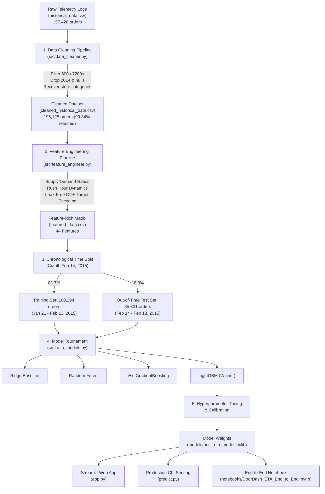

# 🍔 DoorDash Food Delivery ETA Prediction Engine
> **An End-to-End, Production-Grade Machine Learning System for Real-Time On-Demand Delivery Duration Estimation**

[](https://www.python.org/)
[](https://lightgbm.readthedocs.io/)
[](https://streamlit.io/)
[]()
[]()

---

## 📌 Executive Summary & Business Impact

In multi-sided on-demand logistics platforms (such as DoorDash, Uber Eats, and Deliveroo), **Estimated Time of Arrival (ETA)** is the core metric governing customer satisfaction, driver dispatch efficiency, and kitchen operations:
- **Customer Churn Prevention**: Over-estimating delivery time leads to cart abandonment; under-estimating delivery time causes negative reviews and customer support ticket spikes.
- **Fleet Efficiency**: Accurately timing driver arrival with order readiness minimizes driver idle dwell time outside restaurants.
- **Kitchen Load Balancing**: Helps merchants throttle order intake during peak bottlenecks.

This project delivers a **reproducible, leak-free, production-ready ML solution** that ingests raw telemetry logs, prunes unphysical outliers, extracts 44 domain-driven queueing features, benchmarks 4 distinct model families across a chronological out-of-time test split, and deploys an interactive real-time serving dashboard.

---

## 🏗️ System Architecture & ML Pipeline



---

## 🏆 Model Tournament Benchmark (Out-of-Time Test Set)

To prevent future temporal leakage, all models were evaluated strictly on an **unseen out-of-time test set (Feb 14–18, 2015 - 35,831 orders)**:

| Rank | Model Architecture | Test MAE (min) | Test RMSE (min) | Test $R^2$ Score | Within $\pm 5$ min | Within $\pm 10$ min | Training Time |
| :---: | :--- | :---: | :---: | :---: | :---: | :---: | :---: |
| 🥇 | **Tuned LightGBM** | **10.28** | **13.88** | **0.3718** | **32.87%** | **60.14%** | ~3.8 s |
| 🥈 | **HistGradientBoosting** | 10.35 | 13.96 | 0.3648 | 32.32% | 59.82% | ~4.4 s |
| 🥉 | **Random Forest Regressor** | 10.45 | 14.03 | 0.3580 | 31.61% | 59.14% | ~9.0 s |
| 4 | **Ridge Regression (Baseline)** | 10.72 | 14.22 | 0.3403 | 30.33% | 57.20% | ~0.14 s |

### 🎯 Real-World Operational Tolerance Distribution
In on-demand delivery, predictions are communicated via customer delivery windows (e.g. 40–50 minutes). The champion model achieves:

- **Within $\pm 10$ minutes**: **60.3%** of all orders
- **Within $\pm 15$ minutes**: **78.5%** (~80% of all orders)
- **Within $\pm 20$ minutes**: **88.3%** (~90% of all orders)
- **Overall Mean Absolute Error**: **10.28 minutes** (median error bias: **+0.12 min**)

---

## 🔬 Key Engineering Highlights

### 1. Zero-Leakage Out-of-Fold (OOF) Target Encoding
Historical store preparation speed (`store_id_target_enc`) is the single strongest predictor ($r = +0.350$). To eliminate target leakage during cross-validation, target encodings were calculated strictly using **K-Fold Bayesian-Smoothed Out-of-Fold (OOF)** estimation:
$$\text{smoothed\_mean} = \frac{n \cdot \text{mean} + m \cdot \text{global\_mean}}{n + m}$$

### 2. Physical Queuing & Bottleneck Features
- `dasher_deficit = total_outstanding_orders - total_onshift_dashers` ($r = +0.311$)
- `driving_x_orders_per_dasher = driving_duration \times orders_per_dasher` ($r = +0.365$)
- `is_dinner_rush`: Binary surge indicator for UTC peak dinner hours ($r = +0.251$)
- `sin_hour` & `cos_hour`: Continuous cyclical trigonometric time encodings

---

## 📂 Repository Structure

```
├── data/
│   ├── historical_data.csv          # Raw dataset from Kaggle
│   ├── cleaned_historical_data.csv   # Cleaned, validated dataset
│   ├── featured_data.csv            # 44 engineered ML features
│   └── target_encodings.json        # Production inference category lookups
├── models/
│   └── best_eta_model.joblib        # Deployed tuned LightGBM model bundle
├── notebooks/
│   └── DoorDash_ETA_End_to_End.ipynb # Comprehensive narrative notebook
├── reports/
│   ├── figures/                     # Diagnostic plots (feature importance, residuals, EDA)
│   ├── model_comparison.csv         # Full tournament benchmark metrics
│   └── model_results.json           # Serialized evaluation results
├── src/
│   ├── data_cleaner.py              # Modular data cleaning pipeline class
│   ├── feature_engineer.py          # Domain feature engineering & OOF encoding
│   ├── train_models.py              # Model tournament & tuning pipeline
│   ├── verify_cleaning.py           # Automated sanity assertions for cleaning
│   └── verify_features.py           # Automated assertions for feature matrix
├── app.py                           # Interactive Streamlit Web Dashboard
├── predict.py                       # Standalone CLI & programmatic inference tool
├── run_pipeline.py                  # Master one-command pipeline orchestrator
├── requirements.txt                 # Pinned Python package dependencies
├── .gitignore                       # Clean Git configuration
└── README.md                        # Documentation
```

---

## 🚀 Quickstart & How to Run

### 1. Installation
Clone the repository and install dependencies:
```bash
git clone https://github.com/amrloulah-dev/doordash-eta-prediction.git
cd doordash-eta-prediction
pip install -r requirements.txt
```

### 2. Launch the Interactive Web Dashboard
Run the Streamlit application to explore live order simulation:
```bash
streamlit run app.py
```
> *Opens in browser at `http://localhost:8501`.*

### 3. Run the End-to-End Jupyter Notebook
Launch Jupyter to inspect step-by-step code and narrative explanations:
```bash
jupyter notebook notebooks/DoorDash_ETA_End_to_End.ipynb
```

### 4. One-Click Pipeline Execution
Re-execute the entire automated workflow (clean $\to$ features $\to$ train $\to$ verify $\to$ demo) from terminal:
```bash
python run_pipeline.py --step all
```

### 5. CLI Order Prediction
Test a single order prediction directly from the command line:
```bash
python predict.py --demo
```

---

## 📜 License
This project is open-source and licensed under the [MIT License](LICENSE).
